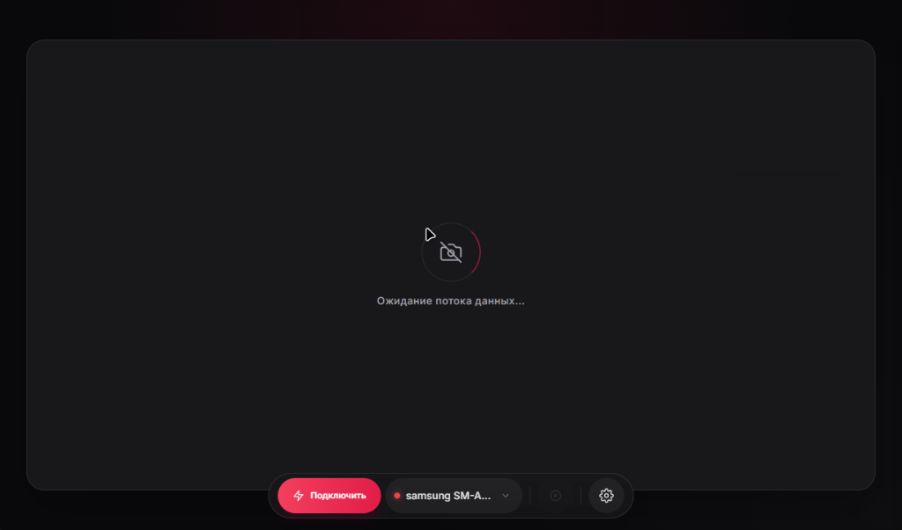

# VirtualCamNative - Android Companion Engine

> Ultra-Low-Latency, Hardware-Accelerated HEVC Wireless and USB Video and Audio Streamer for Windows Virtual Camera.

<p align="center">
  <b>Language / Мова / Язык:</b><br>
  <a href="#virtualcamnative---android-companion-engine">English</a> • 
  <a href="#virtualcamnative-android---руководство-на-русском">Русский</a> • 
  <a href="#virtualcamnative-android---посібник-українською">Українська</a>
</p>

[](https://github.com/dimalinau-lab/Virtual-Camera/releases)
[-3DDC84.svg?style=flat-square&logo=android)](https://developer.android.com/)
[](https://developer.android.com/reference/android/media/MediaCodec)
[](https://developer.android.com/reference/android/hardware/camera2/package-summary)
[](LICENSE)
[-0078D6.svg?style=flat-square&logo=windows)](https://github.com/dimalinau-lab/Virtual-Camera)

<p align="center">
  
  <br>
  <em>VirtualCam Android Viewfinder (Hardware Camera2 multi-lens selector, live battery telemetry, and OLED blackout control)</em>
</p>

<p align="center">
  
  <br>
  <em>VirtualCamNative Desktop Dashboard (DirectShow/Media Foundation receiver with 60 FPS GPU acceleration)</em>
</p>

**VirtualCamNative Android** is a zero-cost, open-source, ultra-low latency mobile streaming engine designed to replace proprietary apps like DroidCam and Iriun. By leveraging **hardware-accelerated HEVC (H.265) encoding** via Android's `MediaCodec`, zero-copy **Camera2 API** surface pipelines, and the companion **C++20 Windows desktop driver** ([VirtualCamNative](https://github.com/dimalinau-lab/Virtual-Camera)), it streams smooth 1080p/4K 60 FPS video directly into **Discord, OBS Studio, Zoom, Telegram, and WebRTC browsers** with ultra-low latency (~10–15 ms over USB, < 30 ms over Wi-Fi).

---

## Technical Specifications

| Parameter | Specification | Details |
| :--- | :--- | :--- |
| **Video Resolutions** | 1080p FHD (1920x1080), 4K UHD (3840x2160), 720p HD (1280x720) | Dynamic reconfiguration via REST API without tearing down sessions |
| **Frame Rates** | 60 FPS, 30 FPS | Hardware 60 FPS capture range `[60, 60]` and unthrottled selfie sensor |
| **Glass-to-Glass Latency** | ~10–15 ms (USB 3.0), < 30 ms (Wi-Fi 5 GHz) | Zero-copy Camera2 Surface to MediaCodec input buffer pipeline |
| **Video Encoder** | Android MediaCodec HEVC (H.265) | Hardware CBR encoding with real-time priority and low-latency flags |
| **Audio Capture** | 48 kHz, 16-bit Mono/Stereo PCM | Native AudioRecord stream with hardware noise suppression |
| **Network Ports** | `8080` (Control Server), `8554` (Video TCP), `8555` (Audio TCP), `8888` (UDP Discovery), `8000` (PC UI) | Automatic ADB port forwarding over USB |
| **Target SDK** | Android 15 (API 35) | Minimum Android 8.0 (API 26) |
| **Release Artifact** | `VirtualCam-v3.0.0.apk` | Companion to `VirtualCamNative_Setup_v3.0.0.exe` |

---

## Key Features

- **Ultra-Low Latency (~10–15 ms USB, < 30 ms Wi-Fi)**: Custom raw TCP transport layer (`TCP_NODELAY`, optimized 64 KB non-blocking socket buffers) paired with advanced `MediaCodec` low-latency tuning (`KEY_LOW_LATENCY`, `KEY_LATENCY=0`, Zero B-Frames, real-time thread priority).
- **Multi-Lens Switching & Hardware Zoom**: Direct physical camera module selection: **0.5x Ultra-Wide**, **1x Wide**, **2x / 3x / 5x Telephoto**, **Macro**, and **Selfie** via Camera2 `CONTROL_ZOOM_RATIO` and vendor auxiliary sensor IDs.
- **Pro Manual Camera Controls**: Fine-grained control over exposure time, ISO sensitivity (100–3200), manual optical focus distance, and Auto White Balance presets directly from the PC client without touching the phone.
- **Secure Device Pairing & Auth Tokens**: Interactive pairing via `/api/pair`: new PC clients trigger an `AlertDialog` prompt on the phone screen. Upon approval, a persistent UUID `auth_token` is generated and saved in `SharedPreferences`. Wi-Fi streaming enforces token verification, while USB ADB is natively trusted.
- **Hardware HEVC / H.265 Compression**: Uses Android's GPU `MediaCodec` hardware encoder (CBR mode with 1s I-frame interval) to maximize image sharpness and save network bandwidth while eliminating CPU thermal throttling on mobile devices.
- **Live Local Viewfinder & OLED Blackout Mode**: Simultaneously routes zero-copy frames to both the hardware encoder and the local phone screen. Includes a tap-to-wake hardware screen blackout overlay (`0.01f` backlight) to prevent OLED burn-in and conserve battery during long streaming sessions.
- **Instant Orientation, FPS & Resolution Switching**: Switch between landscape/portrait aspect ratios, adjust resolutions (720p/1080p/4K), or toggle FPS (30/60) dynamically. The pure `Camera2` implementation hot-swaps active capture sessions without tearing down the underlying `CameraDevice` or dropping the TCP socket.
- **Dual Connection Modes & Auto-Discovery**:
  - **USB Mode:** Zero-lag streaming via automatic ADB port forwarding (`8080`, `8554`, `8555`).
  - **Wi-Fi Mode:** Automatic local network device discovery via **UDP Beacon Broadcasting** (`255.255.255.255:8888`) every 1.5s sending device metadata - no manual IP entry required.
- **Crystal-Clear Raw PCM Audio Stream**: Captures 48 kHz 16-bit audio with hardware noise suppressor flags, transmitting raw PCM over a dedicated TCP stream directly to the Windows DirectShow audio filter.
- **Foreground Service & Thread Safety**: Runs inside a dedicated Android Foreground Service protected by `PARTIAL_WAKE_LOCK` and `WIFI_MODE_FULL_HIGH_PERF`. All hardware lifecycle events execute safely on an isolated `HandlerThread` to prevent Main Thread blocks and HAL crashes.
- **Samsung One UI & Display Cutout Inset Support**: Dynamically adapts to display punch-hole camera cutouts, curved screen edges, and status bars using `WindowInsetsCompat`. Calibrated for Samsung Galaxy A and S series devices so indicators never overlap with camera holes or One UI privacy dots.
- **Floating PIP & Multi-App Overlay Widget**: Draggable, magnetic floating camera preview widget running smoothly above any other Android application, featuring one-tap mic mute, lens flip, eco blackout, and instant return to fullscreen.
- **Real-Time Battery Thermal Guard**: Live hardware battery sensor temperature display (`32°C`) in header badges and telemetry JSON with severe overheating warnings (`OVERHEAT` at >= 42°C).

---

## Comparison with Existing Solutions

| Feature | VirtualCamNative (Android) | DroidCam | Iriun Cam |
| :--- | :---: | :---: | :---: |
| **Video Codec** | **HEVC / H.265 (Hardware)** | H.264 / MJPEG | H.264 / MJPEG |
| **Glass-to-Glass Latency** | **Ultra-Low (~10–15 ms USB)** | ~100 ms – 200 ms | ~80 ms – 150 ms |
| **Physical Multi-Lens (0.5x/1x/2x/Macro)** | **Yes (Camera2 Hardware API)** | No | No |
| **Native DirectShow Driver** | **Yes (Pure C++20 COM DLL)** | Yes (Proprietary) | Yes (Proprietary) |
| **Client Pairing & Security** | **Yes (Token Auth & Modal Alert)** | No | No |
| **OLED Battery Burn-in Saver** | **Yes (0.01f Backlight Overlay)** | Paid Feature | Not Available |
| **Wi-Fi Auto-Discovery** | **Yes (UDP Beacon :8888)** | Partial | Yes |
| **Resolution / FPS Limits** | **None (Full 1080p/4K 60 FPS Unlocked)** | HD Locked / Ads | Watermarked / Paid |
| **Instant Aspect / Config Switch** | **Yes (Zero-Disconnect)** | Requires Disconnect | Requires Restart |
| **License** | **100% Free & Open Source (MIT)** | Closed Source | Closed Source |

---

## System Architecture

```text
 +---------------------------------------------------------------------------------+
 |                        ANDROID CLIENT (HARDWARE SOURCE)                         |
 |              ( https://github.com/dimalinau-lab/Virtual-Camera-Android )        |
 |                                                                                 |
 | [ Pure Camera2 API Engine ] ---> [ Viewfinder Surface ] (Local Phone Screen)    |
 |         │                                                                       |
 |         └───► [ MediaCodec HEVC ] ---> [ Raw TCP Server :8554 ]                 |
 | [ AudioRecord ]          ────► [ Raw 48kHz PCM ]  ---> [ Audio TCP Server :8555 ]|
 |                                                                                 |
 | [ ControlServer :8080 ]  <─── REST API / Auth ──── [ UDP Beacon Broadcaster :8888]
 |   ├── /api/pair (Token Auth & System Dialog Prompt)                             |
 |   ├── /api/lens, /api/connect, /api/config, /api/action, /api/orientation       |
 |   └── /api/unpair, /api/status                                                  |
 +----------------------------------------|----------------------------------------+
                                          | TCP Video/Audio / HTTP REST / UDP Beacon
                                          v
 +---------------------------------------------------------------------------------+
 |                        VIRTUALCAMNATIVE PC CLIENT (C++20)                       |
 |                                                                                 |
 |  [ TcpReceiver ]               [ AudioReceiver (DirectShow Virtual Mic) ]       |
 |         │                                                                       |
 |         ▼ (Anti-Bufferbloat Queue Guard)                                        |
 |  [ NvdecDecoder (FFmpeg Low-Delay) ]                                            |
 |         │                                                                       |
 |         ▼                                                                       |
 |  [ 64x64 Block Rotator ] ───►  [ D3D11 / AVX2 NV12 Blender (60 FPS) ]           |
 |         │                                   │                                   |
 |         ▼                                   ▼                                   |
 |  [ Local MJPEG Preview :8000 ]     [ Win32 Shared Memory MMF ]                  |
 |         │                                   │ Frame Buffer + Sync Events        |
 |  [ WebView2 Desktop GUI ]                   ▼                                   |
 +---------------------------------------------|-----------------------------------+
                                               v
 +---------------------------------------------------------------------------------+
 |                NATIVE VIRTUAL DRIVERS (DIRECTSHOW & MEDIA FOUNDATION)           |
 |                                                                                 |
 |  [ NativeMFVirtualCam.dll ]                                                     |
 |    ├── Video Capture Filter ("Native High-Speed Cam")                           |
 |    └── Audio Capture Filter ("VirtualCam Native Microphone")                    |
 +----------------------------------------|----------------------------------------+
                                          | DirectShow Capture Pins
                                          v
 +---------------------------------------------------------------------------------+
 |                              CONSUMING APPLICATIONS                             |
 |                                                                                 |
 |    Discord    |    OBS Studio    |    Zoom    |    Telegram    |    Browsers    |
 +---------------------------------------------------------------------------------+
```

---

## Quick Start

### Installation
- **Pre-Built APK (Fastest):** Download and install [`VirtualCam-v3.0.0.apk`](https://github.com/dimalinau-lab/Virtual-Camera/releases) directly on your device.
- **Build from Source:** See [Building from Source](#building-from-source).

### USB Mode (Lowest Latency & Maximum Stability)
1. Enable **USB Debugging** on your phone (*Settings -> Developer Options -> USB Debugging*).
2. Connect your phone to your PC via a USB cable.
3. Launch **VirtualCamNative** on your phone and open the [PC Client](https://github.com/dimalinau-lab/Virtual-Camera).
4. Click **USB Connect** on the PC client (ports `8080`, `8554`, `8555` are configured automatically via ADB).

### Wi-Fi Mode (Wireless)
1. Connect both your phone and PC to the same local Wi-Fi router (5 GHz recommended).
2. Open **VirtualCamNative** on your phone.
3. The [PC Client](https://github.com/dimalinau-lab/Virtual-Camera) automatically discovers your phone via **UDP Beacon** (`:8888`).
4. Select your device from the dropdown and click **Wi-Fi Connect**.
5. Tap **Allow** on the confirmation prompt on your phone screen.

---

## Control Server REST API

The Android client runs an embedded HTTP REST server on port `8080` (`ControlServer`) to manage client authorization, remote configuration, and hardware execution:

| Endpoint | Method | Request Payload / Params | Description |
| :--- | :---: | :--- | :--- |
| `/api/pair` | `POST` | `{"client_id": "...", "client_name": "PC"}` | Requests client pairing. Displays an interactive `AlertDialog` prompt on the phone (20s timeout). Returns UUID `auth_token` on approval. |
| `/api/unpair` | `POST` | `{"token": "...", "client_id": "..."}` | Revokes pairing for the specified client and removes the token from `SharedPreferences`. |
| `/api/status` | `GET` | - | Returns JSON status: streaming state, camera facing, torch, mic mute, battery level, battery temp (°C), thermal status, charging flag, manual ISO, exposure time ns, focus distance, and AWB mode. |
| `/api/connect` | `POST` | `{"mode": "usb" \| "wifi", "auth_token": "..."}` | Validates `auth_token` for Wi-Fi connections (USB ADB is trusted). Wakes video encoder and requests an immediate IDR keyframe. |
| `/api/disconnect` | `POST` | - | Safely pauses video streamer and drops client socket. |
| `/api/config` | `POST` | `{"resolution": "1080p", "fps": 60, "bitrate": 10000000}` | Updates encoder resolution (`720p`, `1080p`, `4k`), FPS, and bitrate dynamically with 300ms debouncing. |
| `/api/action` | `POST` | `{"action": "switch_camera" \| "toggle_torch" \| "toggle_blackout" \| "toggle_mic_mute"}` | Toggles front/back camera, torch LED, screen blackout mode, or microphone mute. |
| `/api/lens` | `GET` / `POST` | `?lens=0.5x \| 1x \| 2x \| 3x \| 5x \| macro \| front` | Switches camera sensor optics on the smartphone live. |
| `/api/orientation` | `GET` / `POST` | `?mode=vertical \| horizontal` | Instantly switches frame orientation without dropping the TCP socket. |
| `/api/manual_exposure` | `POST` | `{"iso": 400, "exposure_time_ns": 16666667}` | Configures manual ISO sensitivity (100–3200) and shutter exposure time in nanoseconds. |
| `/api/manual_focus` | `POST` | `{"focus_distance": 2.5}` | Configures manual optical focal distance (0.0 to max diopters). |
| `/api/awb` | `POST` | `{"awb_mode": "auto" \| "daylight" \| "cloudy" \| ...}` | Selects Auto White Balance camera preset. |

### Example REST Requests (Curl)

```bash
# 1. Request Pairing from PC
curl -X POST http://192.168.1.45:8080/api/pair \
     -H "Content-Type: application/json" \
     -d '{"client_id":"my-pc-uuid","client_name":"Gaming Desktop"}'

# 2. Connect with Auth Token
curl -X POST http://192.168.1.45:8080/api/connect \
     -H "Content-Type: application/json" \
     -d '{"mode":"wifi","auth_token":"YOUR_PAIRED_TOKEN"}'

# 3. Switch to Ultra-Wide Lens (0.5x)
curl -X POST "http://192.168.1.45:8080/api/lens?lens=0.5x"

# 4. Toggle Blackout Mode (Save OLED Battery)
curl -X POST http://192.168.1.45:8080/api/action -d '{"action":"toggle_blackout"}'
```

---

## Building from Source

### Requirements
- **Toolchain:** Android Studio Jellyfish / 2024.1+, JDK 17, Gradle 8.x.
- **Minimum SDK:** 26 (Android 8.0) | **Target SDK:** 35 (Android 15)

```bash
# Clone the repository
git clone https://github.com/dimalinau-lab/Virtual-Camera.git
cd Virtual-Camera/android

# Build Debug APK
./gradlew assembleDebug

# Build Release APK
./gradlew assembleRelease
```
Compiled APKs are output to `app/build/outputs/apk/`.

---

## Troubleshooting

- **Pairing prompt does not appear on phone screen**: Ensure `VirtualCamNative` has been granted **"Display over other apps"** (`SYSTEM_ALERT_WINDOW`) permission in Android system settings.
- **Frame rate drops or stuttering on Wi-Fi**: Use a 5 GHz Wi-Fi network rather than congested 2.4 GHz. Disable battery optimization for VirtualCamNative so Android does not throttle background CPU performance.
- **Resolution error when switching to 4K**: Ensure your device camera sensor and hardware HEVC encoder support 4K 60 FPS. If not supported by the hardware HAL, the app falls back to 1080p 60 FPS safely.

---

## License

Distributed under the **MIT License**. See [`LICENSE`](LICENSE) for more information.

---
---

# VirtualCamNative (Android) - Руководство на русском

> Мобильное приложение для Android: аппаратный HEVC-стример видео и звука со сверхнизкой задержкой для ПК.

<p align="center">
  
  <br>
  <em>Видоискатель VirtualCam для Android (чистый интерфейс без системной строки статуса, аппаратное переключение камер, термометрия и режим защиты OLED)</em>
</p>

<p align="center">
  
  <br>
  <em>Панель управления VirtualCamNative для ПК (DirectShow/Media Foundation приемник с 60 FPS ускорением на GPU)</em>
</p>

**VirtualCamNative для Android** — это бесплатное приложение с открытым исходным кодом, превращающее ваш смартфон в высококлассную веб-камеру для ПК. В отличие от DroidCam и Iriun, приложение задействует аппаратный энкодер **HEVC (H.265)** через Android `MediaCodec`, прямой доступ к сенсорам через **Camera2 API** и передает видео и 48 кГц PCM-звук на ПК с задержкой ~10–15 мс по USB и менее 30 мс по Wi-Fi.

---

## Технические характеристики

| Параметр | Значение | Описание |
| :--- | :--- | :--- |
| **Разрешения видео** | 1080p FHD (1920x1080), 4K UHD (3840x2160), 720p HD (1280x720) | Горячая смена параметров без разрыва сокета |
| **Частота кадров** | 60 FPS, 30 FPS | Нативный диапазон `[60, 60]` и честные 60 FPS на селфи-модуле |
| **Задержка (Glass-to-Glass)** | ~10–15 мс (USB 3.0), < 30 мс (Wi-Fi 5 ГГц) | Прямой Surface-конвейер Camera2 в энкодер MediaCodec |
| **Видеоэнкодер** | Android MediaCodec HEVC (H.265) | Аппаратный CBR-энкодер с реальным временем и нулевыми B-кадрами |
| **Аудиозахват** | 48 кГц, 16 бит PCM | Системный поток AudioRecord с аппаратным шумоподавлением |
| **Сетевые порты** | `8080` (Phone API), `8554` (Video TCP), `8555` (Audio TCP), `8888` (UDP Discovery), `8000` (PC UI) | Автоматический проброс через ADB по USB |
| **Требования к Android** | Android 8.0+ (API 26-35) | Целевой SDK 35 (Android 15) |
| **Файл релиза** | `VirtualCam-v3.0.0.apk` | Полная совместимость с `VirtualCamNative_Setup_v3.0.0.exe` |

---

## Ключевые возможности

- **Сверхнизкая задержка (~10–15 мс по USB, < 30 мс по Wi-Fi 5 ГГц)**: Оптимизированный сокет TCP (`TCP_NODELAY`, буфер 64 КБ), тюнинг энкодера (`KEY_LOW_LATENCY`, нулевые B-кадры, максимальный приоритет потока).
- **Переключение физических линз камеры (0.5x / 1x / 2x / 3x / 5x / Макро / Селфи)**: Прямой доступ к сверхширокоугольному, основному, телефото и макро объективам смартфона через аппаратный `CONTROL_ZOOM_RATIO` и вендорные AUX-модули.
- **Ручные настройки съемки Pro Manual**: Дистанционное управление выдержкой, ISO (100–3200), дистанцией фокусировки и балансом белого прямо из интерфейса ПК без необходимости трогать телефон.
- **Безопасное сопряжение и токен авторизации**: При первой попытке подключения с нового ПК на экране телефона появляется системное диалоговое окно с подтверждением. Сгенерированный токен сохраняется в зашифрованных настройках.
- **OLED Blackout — защита экрана от выгорания**: Режим полного затемнения дисплея с минимальной яркостью (`0.01f`), предотвращающий нагрев батареи и выгорание OLED-матриц при долгих трансляциях.
- **Мгновенная смена ориентации и разрешения без разрыва сокета**: Переключение между вертикальным/горизонтальным режимом, с разрешениями 720p, 1080p и 4K при 30 или 60 FPS прямо во время звонка.
- **Чистый PCM-звук 48 кГц**: Передача звука микрофона по отдельному TCP-порту `8555` с системным аппаратным шумоподавлением.
- **Автоматическое обнаружение в сети (UDP Beacon :8888)**: Приложение транслирует широковещательный маяк раз в 1.5 секунды — ПК сам находит телефон без ручного ввода IP-адресов.
- **Адаптация под вырезы экранов и One UI**: Динамический расчет безопасных зон (`WindowInsetsCompat`) под вырезы камер (punch-hole) и системный статус-бар. Индикаторы «В ЭФИРЕ» и температуры не перекрываются вырезами дисплея.
- **Плавающий оверлей и режим PiP**: Возможность свернуть стример в компактный плавающий виджет поверх любых других приложений с быстрым переключением камеры и отключением микрофона.
- **Термомониторинг и защита от перегрева**: Отображение живой температуры аккумулятора (`32°C`) с автоматическим предупреждением о нагреве при >= 42°C.

---

## Быстрый старт

### Способ установки
- **Готовый APK (Рекомендуется):** Скачайте и установите файл [`VirtualCam-v3.0.0.apk`](https://github.com/dimalinau-lab/Virtual-Camera/releases) на смартфон.
- **Сборка из исходников:** Инструкция в разделе [Сборка APK из исходников](#сборка-apk-из-исходников).

### Режим USB (Минимальная задержка)
1. Включите **Отладку по USB** на смартфоне (*Настройки -> Для разработчиков -> Отладка по USB*).
2. Подключите смартфон к ПК кабелем USB.
3. Запустите **VirtualCamNative** на смартфоне и откройте клиент на ПК.
4. Нажмите **USB Connect** на ПК — порты `8080`, `8554` и `8555` пробрасываются автоматически через ADB.

### Режим Wi-Fi (Без проводов)
1. Подключите ПК и смартфон к одной сети Wi-Fi (рекомендуется 5 ГГц).
2. Запустите приложение на смартфоне.
3. Клиент на ПК автоматически обнаружит смартфон через UDP Beacon (`:8888`).
4. Выберите смартфон в списке и нажмите **Wi-Fi Connect**.
5. Нажмите **Разрешить** в окне подтверждения на смартфоне.

---

## Сборка APK из исходников

```bash
git clone https://github.com/dimalinau-lab/Virtual-Camera.git
cd Virtual-Camera/android
./gradlew assembleDebug
```
Готовый файл APK будет находиться в папке `app/build/outputs/apk/debug/app-debug.apk`.

---

## Лицензия

Проект распространяется под лицензией **MIT License**. Подробности в файле [`LICENSE`](LICENSE).

---
---

# VirtualCamNative (Android) - Посібник українською

> Мобільний додаток для Android: апаратний HEVC-стрімер відео та звуку з наднизькою затримкою для ПК.

<p align="center">
  
  <br>
  <em>Видошукач VirtualCam для Android (чистий інтерфейс без системного рядка статусу, апаратний вибір модулів, термометрія та режим захисту OLED)</em>
</p>

<p align="center">
  
  <br>
  <em>Панель керування VirtualCamNative для ПК (DirectShow/Media Foundation приймач із 60 FPS прискоренням на GPU)</em>
</p>

**VirtualCamNative для Android** — це безкоштовний додаток з відкритим вихідним кодом, що перетворює ваш смартфон на висококласну веб-камеру для ПК. На відміну від DroidCam та Iriun, додаток використовує апаратний енкодер **HEVC (H.265)** через Android `MediaCodec`, прямий доступ до сенсорів через **Camera2 API** та передає відео і 48 кГц PCM-звук на ПК із затримкою ~10–15 мс по USB та менше 30 мс по Wi-Fi.

---

## Технічні характеристики

| Параметр | Значення | Опис |
| :--- | :--- | :--- |
| **Роздільна здатність** | 1080p FHD (1920x1080), 4K UHD (3840x2160), 720p HD (1280x720) | Миттєва зміна параметрів без розриву з'єднання |
| **Частота кадрів** | 60 FPS, 30 FPS | Нативний діапазон `[60, 60]` та чесні 60 FPS на селфі-модулі |
| **Затримка (Glass-to-Glass)** | ~10–15 мс (USB 3.0), < 30 мс (Wi-Fi 5 ГГц) | Прямий конвеєр Camera2 Surface в апаратний енкодер MediaCodec |
| **Відеоенкодер** | Android MediaCodec HEVC (H.265) | Апаратний CBR-енкодер із реальним часом та нульовими B-кадрами |
| **Аудіозахоплення** | 48 кГц, 16 біт PCM | Системний потік AudioRecord з апаратним шумопоглинанням |
| **Мережеві порти** | `8080` (Phone API), `8554` (Video TCP), `8555` (Audio TCP), `8888` (UDP Discovery), `8000` (PC UI) | Автоматичне перенаправлення через ADB по USB |
| **Вимоги до Android** | Android 8.0+ (API 26-35) | Цільовий SDK 35 (Android 15) |
| **Файл релізу** | `VirtualCam-v3.0.0.apk` | Повна сумісність із `VirtualCamNative_Setup_v3.0.0.exe` |

---

## Головні можливості

- **Наднизька затримка (~10–15 мс по USB, < 30 мс по Wi-Fi 5 ГГц)**: Оптимізований сокет TCP (`TCP_NODELAY`, буфер 64 КБ), низьколатентний режим енкодера без буферизації.
- **Перемикання фізичних об'єктивів камери (0.5x / 1x / 2x / 3x / 5x / Макро / Селфі)**: Прямий доступ до надширококутного, основного, телефото та макро модулів через апаратний `CONTROL_ZOOM_RATIO`.
- **Ручні налаштування зйомки Pro Manual**: Дистанційне керування витримкою, ISO (100–3200), оптичною дистанцією фокусування та балансом білого прямо з ПК.
- **Безпечне спарення та токен авторизації**: Системне діалогове вікно підтвердження на екрані смартфона при першому підключенні нового ПК.
- **OLED Blackout — захист екрана від вигорання**: Режим повного затемнення дисплея з мінімальною яскравістю (`0.01f`), що запобігає нагріванню та вигоранню матриць.
- **Миттєва зміна орієнтації та роздільної здатності**: Перемикання між вертикальним/горизонтальним режимом, 720p, 1080p та 4K при 30 або 60 FPS прямо під час стріму.
- **Чистий звук 48 кГц PCM**: Окремий TCP-потік звуку на порт `8555` з апаратним шумопоглинанням.
- **Автоматичне виявлення в мережі (UDP Beacon :8888)**: Широкомовний маяк раз на 1.5 секунди для миттєвого знаходження пристрою.
- **Адаптація до вирізів екранів**: Розрахунок безпечних зон під вирізи камер (punch-hole) та системні смуги.
- **Плаваюче вікно та режим PiP**: Згортання у плаваючий віджет поверх інших додатків із кнопками швидкого керування.
- **Термомоніторинг акумулятора**: Живе відображення температури акумулятора (`32°C`) із попередженням про нагрівання.

---

## Швидкий старт

### Спосіб встановлення
- **Готовий APK (Рекомендовано):** Завантажте та встановіть [`VirtualCam-v3.0.0.apk`](https://github.com/dimalinau-lab/Virtual-Camera/releases) на смартфон.
- **Збирання з вихідного коду:** Див. розділ [Збирання APK з вихідного коду](#збирання-apk-з-вихідного-коду).

### Підключення через USB (Рекомендовано)
1. Увімкніть **Налагодження через USB** на смартфоні (*Налаштування -> Параметри розробника -> Налагодження через USB*).
2. Підключіть телефон до ПК через USB-кабель.
3. Запустіть **VirtualCamNative** на смартфоні та відкрийте клієнт на ПК.
4. Натисніть **USB Connect** на ПК — порти `8080`, `8554` та `8555` перенаправляються автоматично.

### Бездротове підключення через Wi-Fi
1. Підключіть ПК та смартфон до однієї мережі Wi-Fi (5 ГГц рекомендовано).
2. Відкрийте додаток на смартфоні.
3. Клієнт на ПК автоматично знайде смартфон через UDP Beacon (`:8888`).
4. Оберіть смартфон зі списку та натисніть **Wi-Fi Connect**.
5. Натисніть **Дозволити** у вікні підтвердження на смартфоні.

---

## Збирання APK з вихідного коду

```bash
git clone https://github.com/dimalinau-lab/Virtual-Camera.git
cd Virtual-Camera/android
./gradlew assembleDebug
```

---

## Ліцензія

Проєкт розповсюджується під ліцензією **MIT License**. Докладніше у файлі [`LICENSE`](LICENSE).
