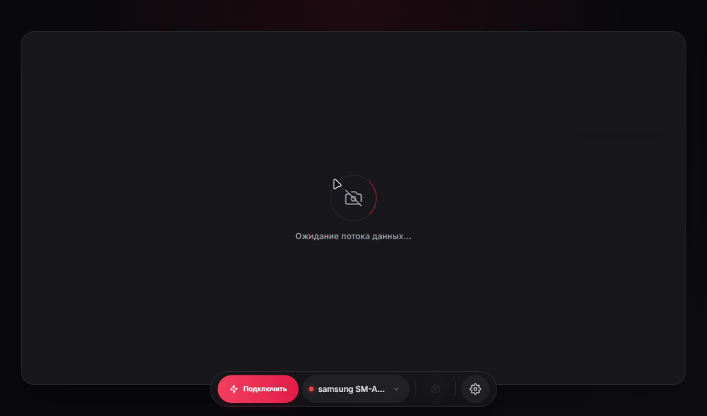

# VirtualCamNative - Android Companion Engine

> Ultra-Low-Latency, Hardware-Accelerated HEVC Wireless and USB Video and Audio Streamer for Windows Virtual Camera.

<p align="center">
  <b>Language / Мова / Язык:</b><br>
  <a href="#virtualcamnative---android-companion-engine">English</a> • 
  <a href="#virtualcamnative-android---руководство-на-русском">Русский</a> • 
  <a href="#virtualcamnative-android---посібник-українською">Українська</a>
</p>

[](https://github.com/dimalinau-lab/Virtual-Camera-Android/releases)
[-3DDC84.svg?style=flat-square&logo=android)](https://developer.android.com/)
[](https://developer.android.com/reference/android/media/MediaCodec)
[](https://developer.android.com/reference/android/hardware/camera2/package-summary)
[](LICENSE)
[-0078D6.svg?style=flat-square&logo=windows)](https://github.com/dimalinau-lab/Virtual-Camera)

<p align="center">
  
  <br>
  <em>VirtualCamNative Desktop Dashboard (DirectShow/Media Foundation receiver with D3D11 GPU acceleration)</em>
</p>

**VirtualCamNative Android** is an open-source, ultra-low-latency mobile streaming engine designed as a free replacement for DroidCam and Iriun. By combining **hardware-accelerated HEVC (H.265) encoding** via `MediaCodec`, a **Camera2 + OpenGL ES** pipeline, and the companion **C++20 Windows driver** ([VirtualCamNative](https://github.com/dimalinau-lab/Virtual-Camera)), it streams 720p/1080p/4K video at up to 60 FPS and 48 kHz PCM audio into **Discord, OBS Studio, Zoom, Telegram, and WebRTC browsers** with ~10–15 ms latency over USB and < 30 ms over 5 GHz Wi-Fi.

---

## Technical Specifications

| Parameter | Specification | Details |
| :--- | :--- | :--- |
| **Video Resolutions** | 1080p FHD (1920x1080), 4K UHD (3840x2160), 720p HD (1280x720) | Hot reconfiguration via `/api/config` synced with PC client |
| **Frame Rates** | 60 FPS, 30 FPS | Filters `[60, 120]` FPS ranges (excludes 240 FPS slow-mo modes like Samsung `SM-A346E` so `720p @ 60 FPS` never black-screens) |
| **Glass-to-Glass Latency** | ~10–15 ms (USB 3.0), < 30 ms (Wi-Fi 5 GHz) | Camera2 Surface -> OpenGL ES -> MediaCodec zero-copy input surface |
| **Video Encoder** | Android `MediaCodec` HEVC (H.265) | Hardware CBR encoding with `KEY_LOW_LATENCY`, zero B-frames, real-time priority |
| **Audio Capture** | 48 kHz, 16-bit PCM | Dedicated `AudioRecord` TCP stream (`:8555`) with hardware NS/AEC |
| **Network Ports** | `8080` (Control Server), `8554` (Video TCP), `8555` (Audio TCP), `8888` (UDP Discovery), `8000` (PC Wake/UI) | Automatic ADB port forwarding over USB |
| **Android SDK** | Min SDK 26 (Android 8.0) \| Target SDK 35 (Android 15) | Compiled with SDK 37, Java 17 toolchain |
| **Release Artifact** | `VirtualCam-v3.1.0.apk` | Companion to `VirtualCam_Setup_v3.1.0.exe` |

---

## Key Features

- **Ultra-Low Latency (~10–15 ms USB, < 30 ms Wi-Fi)**: Raw TCP transport (`TCP_NODELAY`, tuned socket buffers) paired with low-latency `MediaCodec` H.265 encoding (`KEY_LOW_LATENCY`, 1s I-frame interval, zero B-frames).
- **Camera2 + OpenGL ES Pipeline & Auto-Framing**: Dedicated `CameraGlRenderer` and `AutoFramingController` track detected faces via Camera2 Face Detection with smooth EMA crop filtering (up to `2.2x` zoom) and deadband stabilization.
- **Multi-Lens Switching, Hardware Zoom & Stabilization**: Direct physical camera module selection (**0.5x Ultra-Wide**, **1x Wide**, **2x / 3x / 5x Telephoto**, **Macro**, **Front**), smooth `CONTROL_ZOOM_RATIO`, **OIS / EIS Stabilization** toggle, and back-camera **Hardware Torch**.
- **Pro Manual Camera Controls**: Remote control of ISO sensitivity, shutter exposure time (`ns`), optical focus distance (diopters), and AWB presets straight from the PC dashboard.
- **Persistent & Ephemeral Pairing (`PairingManager`)**: Interactive full-screen/notification pairing prompt (`PairingRequestActivity` & `PairingActionReceiver`) offering **Always Allow** (persisted UUID token recognized across DHCP IP changes), **Only Once** (24h ephemeral token), or **Decline**. USB ADB loopback connections are natively trusted.
- **Auto Wake PC on Launch (`PcWakeManager`)**: Automatically sends `/api/wake` to the paired PC client over USB ADB (`127.0.0.1:8000`) or cached Wi-Fi IP when the app opens.
- **In-App Auto-Updater (`UpdateManager`)**: Checks GitHub Releases (`Virtual-Camera-Android`), downloads the APK over HTTPS, and verifies package name and signing certificate before launching the Android package installer.
- **Trilingual UI & Language Selector (`LocaleHelper`)**: Switch directly in-app between **Auto (System)**, **English (EN)**, **Russian (RU)**, and **Ukrainian (UK)**.
- **OLED Eco-Blackout & Gyro Wake**: Tap-to-wake screen blackout and optional 30-second gyro-aware auto-dimming to prevent OLED burn-in and conserve battery.
- **Samsung One UI Cutouts, PiP & Floating Overlay**: Safe-area `WindowInsetsCompat` positioning around punch-hole cameras, Android Picture-in-Picture (`Flip`, `Mic`, `Stop` remote actions), and draggable floating preview overlay.
- **Real-Time Thermal Monitoring**: Live battery temperature badge (`°C`) with automatic `OVERHEAT` alert (`>= 42°C`).

---

## Comparison with Existing Solutions

| Feature | VirtualCamNative (Android) | DroidCam | Iriun Cam |
| :--- | :---: | :---: | :---: |
| **Video Codec** | **HEVC / H.265 (Hardware)** | H.264 / MJPEG | H.264 / MJPEG |
| **Glass-to-Glass Latency** | **~10–15 ms (USB)** | ~100–200 ms | ~80–150 ms |
| **Multi-Lens & Auto-Framing** | **Yes (Camera2 + OpenGL ES Face Tracking)** | No | No |
| **Native PC Driver** | **Yes (`VirtualCam.dll` C++20 COM)** | Yes (Proprietary) | Yes (Proprietary) |
| **Pairing & Auth Tokens** | **Yes (Always / Once / Decline + DHCP Token)** | No | No |
| **OLED Eco-Blackout** | **Yes (Gyro Auto-Dimming + Tap Wake)** | Paid Feature | Not Available |
| **Wi-Fi Discovery & PC Wake** | **Yes (UDP :8888 + `/api/wake`)** | Partial | Yes |
| **Resolution / FPS Limits** | **None (720p/1080p/4K up to 60 FPS)** | HD Locked / Ads | Watermarked / Paid |
| **License** | **100% Free & Open Source (MIT)** | Closed Source | Closed Source |

---

## System Architecture

```text
 +---------------------------------------------------------------------------------+
 |                        ANDROID CLIENT (HARDWARE SOURCE)                         |
 |              ( https://github.com/dimalinau-lab/Virtual-Camera-Android )        |
 |                                                                                 |
 | [ Camera2 API ] -> [ CameraGlRenderer (OpenGL ES + Auto-Framing) ] -> Viewfinder|
 |                                    │                                            |
 |                                    └──► [ MediaCodec HEVC ] ---> [ TCP :8554 ]  |
 | [ AudioRecord (48kHz PCM) ]                                 ---> [ TCP :8555 ]  |
 |                                                                                 |
 | [ ControlServer :8080 ]  <─── REST / PairingManager <─── [ UDP Beacon :8888 ]   |
 |   ├── /api/pair, /api/unpair, /api/connect, /api/disconnect                     |
 |   ├── /api/config, /api/lens, /api/zoom, /api/stabilization, /api/camera_unit   |
 |   └── /api/action, /api/orientation, /api/status, /api/diagnostics              |
 | [ PcWakeManager ] ───────────► PC :8000 (/api/wake)   [ UpdateManager ] -> GitHub|
 +----------------------------------------|----------------------------------------+
                                          | TCP Video/Audio / HTTP REST / UDP Beacon
                                          v
 +---------------------------------------------------------------------------------+
 |                          VIRTUALCAM PC CLIENT (C++20)                           |
 |                                                                                 |
 |  [ TcpReceiver ]               [ AudioReceiver (WASAPI Dual-Mic + Studio DSP) ] |
 |         │                                                                       |
 |         ▼ (Anti-Bufferbloat FIONREAD Queue Guard)                               |
 |  [ NvdecDecoder (D3D11VA / NVDEC / FFmpeg) ]                                    |
 |         │                                                                       |
 |         ▼                                                                       |
 |  [ D3D11 Optics Pipeline (3D LUT, Zoom/Pan, Aspect, 60 FPS Synth, Troll FX) ]   |
 |         │                                   │                                   |
 |         ▼                                   ▼                                   |
 |  [ Local MJPEG Preview :8000 ]     [ Win32 Shared Memory MMF ]                  |
 |         │                                   │ NV12 Frame Buffer + Sync Events   |
 |  [ WebView2 Desktop GUI ]                   ▼                                   |
 +---------------------------------------------|-----------------------------------+
                                               v
 +---------------------------------------------------------------------------------+
 |                NATIVE VIRTUAL DRIVERS (DIRECTSHOW & MEDIA FOUNDATION)           |
 |                                                                                 |
 |  [ VirtualCam.dll ] (SSE2 NV12->I420 & 2x2 Scaler)                              |
 |    ├── Video Capture Filter ("Native High-Speed Cam")                           |
 |    └── Audio Capture Filter ("VirtualCam Native Microphone")                    |
 +----------------------------------------|----------------------------------------+
                                          | DirectShow / MF Capture Pins
                                          v
 +---------------------------------------------------------------------------------+
 |                              CONSUMING APPLICATIONS                             |
 |                                                                                 |
 |    Discord    |    OBS Studio    |    Zoom    |    Telegram    |    Browsers    |
 +---------------------------------------------------------------------------------+
```

---

## Quick Start

### Installation
- **Pre-Built APK (Fastest):** Download and install [`VirtualCam-v3.1.0.apk`](https://github.com/dimalinau-lab/Virtual-Camera-Android/releases) (or from the [PC Releases page](https://github.com/dimalinau-lab/Virtual-Camera/releases)).
- **Build from Source:** See [Building from Source](#building-from-source).

### USB Mode (Lowest Latency & Maximum Stability)
1. Enable **USB Debugging** on your phone (*Settings -> Developer Options -> USB Debugging*).
2. Connect your phone to your PC via USB.
3. Launch **VirtualCamNative** on your phone and open `VirtualCam.exe` from the [PC Client](https://github.com/dimalinau-lab/Virtual-Camera).
4. Click **Connect** / **USB** on the PC client (ports `8080`, `8554`, and `8555` are forwarded automatically via ADB).

### Wi-Fi Mode (Wireless)
1. Connect both your phone and PC to the same Wi-Fi network (5 GHz recommended).
2. Open **VirtualCamNative** on your phone (if paired earlier, `PcWakeManager` can wake the PC client automatically).
3. The PC client automatically discovers your phone via **UDP Beacon** (`:8888`).
4. Select your device and click **Connect**.
5. On first connection, tap **Always Allow** or **Only Once** on your phone screen.

---

## Control Server REST API

The Android app runs an embedded HTTP REST server on port `8080` (`ControlServer`) protected by `auth_token` (`X-Auth-Token` header or JSON/query `auth_token`) for Wi-Fi requests:

| Endpoint | Method | Request Payload / Params | Description |
| :--- | :---: | :--- | :--- |
| `/api/pair` | `POST` | `{"client_id": "...", "client_name": "PC"}` | Displays pairing prompt (`Always Allow` / `Only Once` / `Decline`, 25s timeout) and returns UUID `auth_token`. |
| `/api/unpair` | `POST` | `{"token": "...", "client_id": "..."}` | Revokes persistent/ephemeral pairing token. |
| `/api/connect` | `POST` | `{"mode": "usb" \| "wifi", "auth_token": "..."}` | Validates token (USB loopback is trusted), wakes encoder, and emits immediate IDR keyframe. |
| `/api/disconnect` | `POST` | - | Stops active streaming client session. |
| `/api/config` | `POST` | `{"resolution": "1080p", "fps": 60, "bitrate": 7000000}` | Dynamically updates resolution (`720p`, `1080p`, `4k`), FPS, and bitrate (150 ms debounce). |
| `/api/action` | `POST` | `{"action": "switch_camera" \| "toggle_torch" \| "toggle_blackout" \| "toggle_mic_mute" \| "toggle_stabilization" \| "set_lens" \| "set_zoom" \| "set_camera_unit"}` | Executes camera, torch, blackout, mute, lens, zoom, or stabilization actions. |
| `/api/lens` | `GET` / `POST` | `?lens=0.5x \| 1x \| 2x \| 3x \| 5x \| macro \| front` | Switches active lens. |
| `/api/zoom` | `GET` / `POST` | `?ratio=1.0` | Sets Camera2 optical/zoom ratio. |
| `/api/stabilization` | `GET` / `POST` | `?enabled=true\|false` | Enables or disables OIS/EIS stabilization. |
| `/api/camera_unit` | `GET` / `POST` | `?id=0&is_physical=false` | Selects a specific logical or physical Camera2 unit ID. |
| `/api/orientation` | `GET` / `POST` | `?mode=vertical \| horizontal` | Switches frame orientation without dropping TCP connection. |
| `/api/manual_exposure` | `POST` | `{"iso": 400, "exposure_time_ns": 16666667}` | Sets manual ISO and shutter exposure time in nanoseconds. |
| `/api/manual_focus` | `POST` | `{"focus_distance": 2.5}` | Sets manual optical focal distance in diopters. |
| `/api/awb` | `POST` | `{"awb_mode": "auto" \| "daylight" \| ...}` | Sets Auto White Balance preset. |
| `/api/status` | `GET` | - | Returns JSON status: streaming state, facing, torch, mic mute, lens, zoom, battery temp/level, thermal status, FPS ranges, camera units, OIS/EIS, and auto-framing. |
| `/api/diagnostics` | `GET` | - | Returns internal Camera2 / encoder / network diagnostics JSON. |

### Example REST Requests (Curl)

```bash
# 1. Request Pairing from PC
curl -X POST http://192.168.1.45:8080/api/pair \
     -H "Content-Type: application/json" \
     -d '{"client_id":"my-pc-uuid","client_name":"Gaming Desktop"}'

# 2. Connect with Auth Token
curl -X POST http://192.168.1.45:8080/api/connect \
     -H "Content-Type: application/json" \
     -d '{"mode":"wifi","auth_token":"YOUR_PAIRED_TOKEN"}'

# 3. Switch to Ultra-Wide Lens (0.5x)
curl -X POST "http://192.168.1.45:8080/api/lens?lens=0.5x" \
     -H "X-Auth-Token: YOUR_PAIRED_TOKEN"

# 4. Toggle Blackout Mode (Save OLED Battery)
curl -X POST http://192.168.1.45:8080/api/action \
     -H "X-Auth-Token: YOUR_PAIRED_TOKEN" \
     -d '{"action":"toggle_blackout"}'
```

---

## Building from Source

### Requirements
- **Toolchain:** Android Studio (AGP 8.x+), JDK 17, Gradle.
- **SDK Levels:** Minimum SDK 26 (Android 8.0) | Target SDK 35 (Android 15) | Compile SDK 37.

```bash
# Clone the repository
git clone https://github.com/dimalinau-lab/Virtual-Camera-Android.git
cd Virtual-Camera-Android

# Build Debug APK
./gradlew assembleDebug

# Build Release APK
./gradlew assembleRelease
```
Compiled APKs are output to `app/build/outputs/apk/`.

---

## Troubleshooting

- **Pairing prompt does not appear over other apps**: Grant **"Display over other apps"** (`SYSTEM_ALERT_WINDOW`) and **Notifications** permissions; you can also accept pairing directly from the system notification buttons (`Always Allow` / `Only Once`).
- **Frame rate drops or stuttering on Wi-Fi**: Use a 5 GHz Wi-Fi network rather than congested 2.4 GHz, and exclude `VirtualCamNative` from Android battery restrictions.
- **4K or 60 FPS fallback**: If a sensor/encoder does not expose a compatible 4K or `[60, 120]` FPS Camera2 range, the streamer falls back safely to the highest supported configuration.

---

## License

Distributed under the **MIT License**. See [`LICENSE`](LICENSE) for more information.

---
---

# VirtualCamNative (Android) - Руководство на русском

> Мобильное приложение для Android: аппаратный HEVC-стример видео и звука со сверхнизкой задержкой для ПК.

<p align="center">
  
  <br>
  <em>Панель управления VirtualCamNative для ПК (приёмник DirectShow/Media Foundation с ускорением на D3D11 GPU)</em>
</p>

**VirtualCamNative для Android** — это бесплатное приложение с открытым исходным кодом, превращающее смартфон в качественную веб-камеру и микрофон для ПК. В отличие от DroidCam и Iriun, приложение задействует аппаратный энкодер **HEVC (H.265)** через Android `MediaCodec`, конвейер **Camera2 + OpenGL ES** и парный **C++20 драйвер Windows** (`VirtualCam.dll`), передавая видео и 48 кГц PCM-звук с задержкой ~10–15 мс по USB и < 30 мс по Wi-Fi 5 ГГц.

---

## Технические характеристики

| Параметр | Значение | Описание |
| :--- | :--- | :--- |
| **Разрешения видео** | 1080p FHD (1920x1080), 4K UHD (3840x2160), 720p HD (1280x720) | Горячая смена параметров через `/api/config` с синхронизацией с ПК |
| **Частота кадров** | 60 FPS, 30 FPS | Фильтрация диапазонов `[60, 120]` FPS (исключены slow-mo режимы `240 FPS` вроде Samsung `SM-A346E`, устраняющая чёрный экран на `720p @ 60 FPS`) |
| **Задержка (Glass-to-Glass)** | ~10–15 мс (USB 3.0), < 30 мс (Wi-Fi 5 ГГц) | Прямой Surface-конвейер Camera2 -> OpenGL ES -> MediaCodec |
| **Видеоэнкодер** | Android `MediaCodec` HEVC (H.265) | Аппаратный CBR-энкодер с `KEY_LOW_LATENCY` и нулевыми B-кадрами |
| **Аудиозахват** | 48 кГц, 16 бит PCM | Поток `AudioRecord` (`:8555`) с аппаратным шумоподавлением |
| **Сетевые порты** | `8080` (Phone API), `8554` (Video TCP), `8555` (Audio TCP), `8888` (UDP Discovery), `8000` (PC Wake/UI) | Автоматический проброс через ADB по USB |
| **Требования к Android** | Android 8.0+ (API 26), Target SDK 35 (Android 15) | Compile SDK 37, JDK 17 |
| **Файл релиза** | `VirtualCam-v3.1.0.apk` | Полная совместимость с `VirtualCam_Setup_v3.1.0.exe` |

---

## Ключевые возможности

- **Сверхнизкая задержка (~10–15 мс по USB, < 30 мс по Wi-Fi 5 ГГц)**: Сокет TCP с `TCP_NODELAY`, тюнинг энкодера (`KEY_LOW_LATENCY`, I-кадры раз в секунду, нулевые B-кадры).
- **OpenGL ES и автокадрирование лица (`AutoFramingController`)**: Анализ координат лиц из Camera2 Face Detection и плавный шейдерный кроп (до `2.2x`) с зоной нечувствительности.
- **Переключение физических линз, зум и стабилизация**: Доступ к **0.5x**, **1x**, **2x / 3x / 5x**, **Макро** и **Селфи** модулям, плавный `CONTROL_ZOOM_RATIO`, **OIS / EIS стабилизация** и управление **вспышкой/фонариком**.
- **Ручные настройки Pro Manual**: Дистанционное управление ISO, выдержкой (`ns`), дистанцией фокусировки и балансом белого (AWB) с ПК.
- **Постоянное и разовое сопряжение (`PairingManager`)**: Диалог и уведомление с кнопками **Всегда разрешать** (постоянный UUID-токен, узнаваемый даже после смены IP по DHCP), **Только один раз** (токен на 24 ч) и **Отклонить**. Подключение по USB ADB доверяется автоматически.
- **Автопробуждение ПК (`PcWakeManager`)**: При запуске приложения смартфон автоматически отправляет `/api/wake` на ПК по USB ADB или сохранённому Wi-Fi IP.
- **Встроенное автообновление (`UpdateManager`)**: Проверка GitHub Releases, скачивание APK с проверкой идентификатора пакета и подписи перед установкой.
- **Трёхъязычный выбор языка (`LocaleHelper`)**: Переключение прямо в интерфейсе между **Системным**, **English**, **Русский** и **Українська**.
- **OLED Blackout и гиро-затухание**: Затемнение экрана по касанию или автоматически через 30 секунд простоя по гироскопу.
- **Адаптация под One UI, PiP и плавающий виджет**: Учёт вырезов экрана (`WindowInsetsCompat`), режим Картинка-в-картинке (`Flip`, `Mic`, `Stop`), плавающий оверлей поверх других приложений и термомониторинг (`OVERHEAT` при `>= 42°C`).

---

## Быстрый старт

### Способ установки
- **Готовый APK (Рекомендуется):** Скачайте и установите [`VirtualCam-v3.1.0.apk`](https://github.com/dimalinau-lab/Virtual-Camera-Android/releases) (или со страницы [релизов ПК](https://github.com/dimalinau-lab/Virtual-Camera/releases)).
- **Сборка из исходников:** См. [Сборка APK из исходников](#сборка-apk-из-исходников).

### Режим USB (Минимальная задержка)
1. Включите **Отладку по USB** на смартфоне (*Настройки -> Для разработчиков -> Отладка по USB*).
2. Подключите смартфон к ПК кабелем USB.
3. Запустите **VirtualCamNative** на смартфоне и `VirtualCam.exe` на ПК.
4. Нажмите **Подключить** / **USB** на ПК — порты `8080`, `8554` и `8555` пробрасываются автоматически.

### Режим Wi-Fi (Без проводов)
1. Подключите ПК и смартфон к одной сети Wi-Fi (рекомендуется 5 ГГц).
2. Запустите приложение на смартфоне.
3. Клиент на ПК автоматически обнаружит смартфон через UDP Beacon (`:8888`).
4. Выберите смартфон в списке и нажмите **Подключить**.
5. При первом подключении нажмите **Всегда разрешать** или **Только один раз** на смартфоне.

---

## Сборка APK из исходников

```bash
git clone https://github.com/dimalinau-lab/Virtual-Camera-Android.git
cd Virtual-Camera-Android
./gradlew assembleDebug
```
Готовый файл APK будет находиться в `app/build/outputs/apk/debug/app-debug.apk`.

---

## Лицензия

Проект распространяется под лицензией **MIT License**. Подробности в файле [`LICENSE`](LICENSE).

---
---

# VirtualCamNative (Android) - Посібник українською

> Мобільний додаток для Android: апаратний HEVC-стрімер відео та звуку з наднизькою затримкою для ПК.

<p align="center">
  
  <br>
  <em>Панель керування VirtualCamNative для ПК (приймач DirectShow/Media Foundation із прискоренням на D3D11 GPU)</em>
</p>

**VirtualCamNative для Android** — це безкоштовний додаток з відкритим вихідним кодом, що перетворює смартфон на висококласну веб-камеру та мікрофон для ПК. На відміну від DroidCam та Iriun, додаток використовує апаратний енкодер **HEVC (H.265)** через Android `MediaCodec`, конвеєр **Camera2 + OpenGL ES** та парний **C++20 драйвер Windows** (`VirtualCam.dll`), передаючи відео й 48 кГц PCM-звук із затримкою ~10–15 мс по USB та < 30 мс по Wi-Fi 5 ГГц.

---

## Технічні характеристики

| Параметр | Значення | Опис |
| :--- | :--- | :--- |
| **Роздільна здатність** | 1080p FHD (1920x1080), 4K UHD (3840x2160), 720p HD (1280x720) | Гаряча зміна параметрів через `/api/config` із синхронізацією з ПК |
| **Частота кадрів** | 60 FPS, 30 FPS | Фільтрація діапазонів `[60, 120]` FPS (виключені slow-mo режими `240 FPS` як на Samsung `SM-A346E`, що усуває чорний екран на `720p @ 60 FPS`) |
| **Затримка (Glass-to-Glass)** | ~10–15 мс (USB 3.0), < 30 мс (Wi-Fi 5 ГГц) | Прямий конвеєр Camera2 Surface -> OpenGL ES -> MediaCodec |
| **Відеоенкодер** | Android `MediaCodec` HEVC (H.265) | Апаратний CBR-енкодер із `KEY_LOW_LATENCY` та нульовими B-кадрами |
| **Аудіозахоплення** | 48 кГц, 16 біт PCM | Потік `AudioRecord` (`:8555`) з апаратним шумопоглинанням |
| **Мережеві порти** | `8080` (Phone API), `8554` (Video TCP), `8555` (Audio TCP), `8888` (UDP Discovery), `8000` (PC Wake/UI) | Автоматичне перенаправлення через ADB по USB |
| **Вимоги до Android** | Android 8.0+ (API 26), Target SDK 35 (Android 15) | Compile SDK 37, JDK 17 |
| **Файл релізу** | `VirtualCam-v3.1.0.apk` | Повна сумісність із `VirtualCam_Setup_v3.1.0.exe` |

---

## Головні можливості

- **Наднизька затримка (~10–15 мс по USB, < 30 мс по Wi-Fi 5 ГГц)**: Оптимізований сокет TCP (`TCP_NODELAY`), низьколатентний режим енкодера без B-кадрів.
- **OpenGL ES та автокадрування обличчя (`AutoFramingController`)**: Відстеження облич через Camera2 Face Detection із плавним шейдерним кропом (до `2.2x`).
- **Перемикання фізичних об'єктивів, зум і стабілізація**: Доступ до **0.5x**, **1x**, **2x / 3x / 5x**, **Макро** та **Селфі** модулів, плавний `CONTROL_ZOOM_RATIO`, **OIS / EIS стабілізація** та керування **ліхтариком**.
- **Ручні налаштування Pro Manual**: Дистанційне керування ISO, витримкою (`ns`), фокусом та балансом білого (AWB) з ПК.
- **Постійне та разове спарення (`PairingManager`)**: Діалог і сповіщення з кнопками **Дозволяти завжди** (постійний UUID-токен, що впізнається після зміни IP по DHCP), **Лише один раз** (токен на 24 год) та **Відхилити**. USB ADB довіряється автоматично.
- **Автопробудження ПК (`PcWakeManager`)**: Під час запуску додаток автоматично надсилає `/api/wake` на ПК через USB ADB або збережений Wi-Fi IP.
- **Вбудоване автооновлення (`UpdateManager`)**: Перевірка GitHub Releases, завантаження APK із перевіркою ідентифікатора пакета та підпису перед встановленням.
- **Тримовний вибір мови (`LocaleHelper`)**: Перемикання в інтерфейсі між **Системною**, **English**, **Русский** та **Українська**.
- **OLED Blackout і гіро-затемнення**: Захист OLED-дисплея від вигорання з пробудженням дотиком або рухом телефона.
- **Адаптація під One UI, PiP і плаваючий віджет**: Врахування вирізів екрана (`WindowInsetsCompat`), режим Картинка-в-картинці (`Flip`, `Mic`, `Stop`), плаваючий оверлей та термомоніторинг (`OVERHEAT` від `>= 42°C`).

---

## Швидкий старт

### Спосіб встановлення
- **Готовий APK (Рекомендовано):** Завантажте та встановіть [`VirtualCam-v3.1.0.apk`](https://github.com/dimalinau-lab/Virtual-Camera-Android/releases) (або зі сторінки [релізів ПК](https://github.com/dimalinau-lab/Virtual-Camera/releases)).
- **Збирання з вихідного коду:** Див. [Збирання APK з вихідного коду](#збирання-apk-з-вихідного-коду).

### Підключення через USB (Рекомендовано)
1. Увімкніть **Налагодження через USB** на смартфоні (*Налаштування -> Параметри розробника -> Налагодження через USB*).
2. Підключіть телефон до ПК через USB-кабель.
3. Запустіть **VirtualCamNative** на смартфоні та `VirtualCam.exe` на ПК.
4. Натисніть **Підключити** / **USB** на ПК — порти `8080`, `8554` та `8555` перенаправляються автоматично.

### Бездротове підключення через Wi-Fi
1. Підключіть ПК та смартфон до однієї мережі Wi-Fi (5 ГГц рекомендовано).
2. Відкрийте додаток на смартфоні.
3. Клієнт на ПК автоматично знайде смартфон через UDP Beacon (`:8888`).
4. Оберіть смартфон зі списку та натисніть **Підключити**.
5. Під час першого підключення оберіть **Дозволяти завжди** або **Лише один раз** на смартфоні.

---

## Збирання APK з вихідного коду

```bash
git clone https://github.com/dimalinau-lab/Virtual-Camera-Android.git
cd Virtual-Camera-Android
./gradlew assembleDebug
```
Зібраний APK знаходиться у `app/build/outputs/apk/debug/app-debug.apk`.

---

## Ліцензія

Проєкт розповсюджується під ліцензією **MIT License**. Докладніше у файлі [`LICENSE`](LICENSE).
